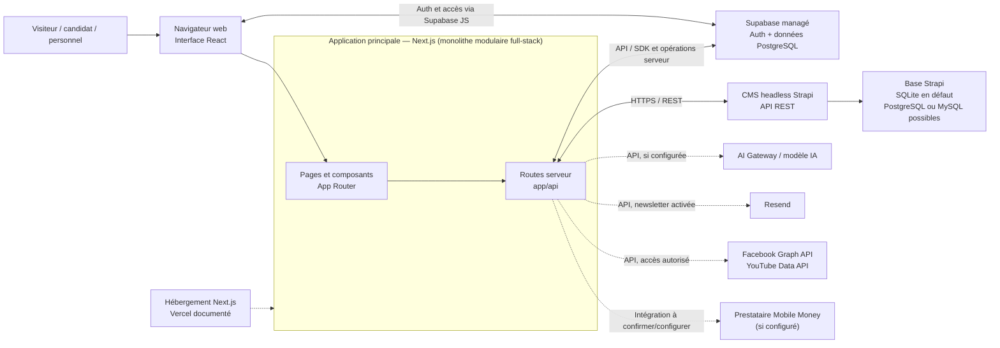

# Cahier des charges — Plateforme numérique de l'INPTIC

## 1. Objet du document

Ce document décrit le périmètre fonctionnel et les exigences principales de la
plateforme web de l'Institut National de la Poste, des Technologies de
l'Information et de la Communication (INPTIC). Il formalise les fonctionnalités
présentes dans le projet et les conditions nécessaires à leur mise en service.
Il ne vaut pas promesse de disponibilité d'un service externe non configuré.

## 2. Contexte et objectifs

La plateforme doit fournir un point d'accès numérique commun aux candidats,
étudiants, personnels, partenaires et visiteurs. Elle doit :

- présenter l'institut, ses formations, ses actualités et ses activités de
  recherche;
- accompagner les candidats de la préinscription au suivi de leur dossier;
- fournir des espaces de travail adaptés aux équipes autorisées;
- faciliter la publication et la consultation de contenus institutionnels;
- fonctionner sur les formats d'écran courants et permettre une navigation
  claire depuis un navigateur web.

## 3. Utilisateurs et habilitations

| Profil | Besoins principaux |
| --- | --- |
| Visiteur | Découvrir l'INPTIC, ses formations, actualités, services et coordonnées. |
| Candidat | Créer un compte, se préinscrire, déposer des pièces, suivre son dossier et consulter sa quittance. |
| Personnel de scolarité | Examiner les dossiers, traiter les candidatures et publier des documents étudiants. |
| Direction des études | Accéder aux outils qui lui sont attribués pour le suivi des études. |
| Direction générale | Consulter les indicateurs de suivi et les informations de direction. |
| Communication | Gérer les annonces, actualités et activités de veille accessibles dans son espace. |
| Personnel RH | Consulter ou gérer les dossiers RH selon son niveau d'autorisation. |
| Administrateur | Administrer les espaces et opérations autorisés au compte. |

Les rôles applicatifs comprennent notamment `admin`, `directeur`,
`communication`, `scolarite`, `direction_etudes` et `etudiant`; les variantes
connues (par exemple `dg`, `administrateur`, `drh` ou
`responsable_communication`) sont normalisées. Les droits sont contrôlés selon
la ressource et l'action; ils ne doivent pas être déduits du seul lien affiché
dans la navigation. Les règles de normalisation et les destinations sont
centralisées dans [`lib/roles.ts`](./lib/roles.ts).

## 4. Périmètre fonctionnel

### 4.1 Portail public

Le portail présente l'institut et sa gouvernance, le catalogue de formations,
les admissions, les actualités, annonces, concours et résultats, la recherche
scientifique, la vie étudiante, les entreprises, les alumni, les textes et lois,
les contacts et une visite 3D. Les visiteurs peuvent rechercher des contenus,
consulter les pages et utiliser les fonctions de partage disponibles.

### 4.2 Comptes et admissions

- Inscription et connexion des candidats, avec authentification Supabase en
  production.
- Parcours de préinscription et dépôt du dossier officiel.
- Téléversement des pièces obligatoires selon les formats et limites présentés
  par le formulaire.
- Consultation de l'avancement du dossier et du statut de paiement.
- Demande de réinitialisation du mot de passe par courriel.
- Paiement via les moyens Mobile Money présentés dans l'application, sous
  réserve de la configuration et de la confirmation du prestataire.
- Génération et consultation d'une quittance lorsque le paiement est confirmé.

Les écrans doivent signaler les étapes manquantes et orienter le candidat vers
l'action suivante. Les migrations de base de données requises doivent être
appliquées avant l'utilisation en production.

### 4.3 Espaces du personnel

- **Annonces et communication** : créer, modifier et retirer des annonces;
  consulter les outils de veille et préparer le partage sur les réseaux.
- **Concours** : gérer les fiches de concours, documents officiels,
  préinscriptions et résultats publiés.
- **Scolarité** : examiner, valider ou refuser les dossiers et publier des
  documents étudiants.
- **Direction** : consulter le tableau de bord et modifier les paramètres de
  compte proposés.
- **Ressources humaines** : rechercher et gérer les profils, importer ou
  exporter des données, gérer les cartes/QR codes et consulter les statistiques
  et le journal d'audit, selon les permissions.
- **Catalogue et recherche** : gérer les ressources de formation et les
  publications scientifiques pour les comptes disposant des droits requis.

Les opérations sensibles doivent demander une confirmation lorsque cela est
prévu. L'archivage RH est réversible; la suppression définitive ou la révocation
d'un QR doit être présentée comme une action à vérifier avant confirmation.

### 4.4 Assistant, actualités et services complémentaires

- L'assistant conversationnel répond en français à partir du contexte
  documentaire disponible et peut utiliser les outils activés.
- Les actualités permettent la consultation et les interactions de type
  appréciation et partage.
- Les outils de veille peuvent agréger des sources configurées, afficher leur
  état et préparer la diffusion d'un contenu.
- La newsletter permet l'inscription, l'envoi ciblé et le désabonnement lorsque
  les services et le schéma de données requis sont activés.

Le partage ouvre les services externes : il ne confirme pas qu'une publication
a été effectuée sur le compte institutionnel. La réponse automatique aux
commentaires YouTube et la publication sociale entièrement automatisée ne font
pas partie du périmètre décrit.

## 5. Exigences non fonctionnelles

- **Compatibilité** : application web fondée sur Next.js, React et TypeScript;
  prise en charge des navigateurs modernes et des écrans mobiles et de bureau.
- **Sécurité des comptes** : les actions réservées doivent être vérifiées côté
  serveur à partir d'une identité authentifiée et d'autorisations fiables.
- **Protection des secrets** : les clés privées et jetons de service doivent
  rester dans les variables d'environnement serveur, sans préfixe
  `NEXT_PUBLIC_`.
- **Protection des données** : limiter l'accès aux informations de candidature
  et aux dossiers RH aux seuls comptes autorisés; ne rendre publiques que les
  données explicitement prévues.
- **Fiabilité des transactions** : afficher le statut confirmé par le prestataire
  avant de considérer un paiement comme réussi et prévenir les relances
  involontaires.
- **Traçabilité RH** : conserver les événements d'audit disponibles pour les
  opérations RH sensibles.
- **Clarté** : présenter les états d'attente, d'erreur, de succès et les étapes
  à suivre sans assimiler une donnée de secours à une source vérifiée.
- **Maintenabilité** : centraliser les règles réutilisées, notamment les rôles,
  et documenter les configurations externes nécessaires.

## 6. Architecture et dépendances

### 6.1 Technologies utilisées

Les versions ci-dessous sont celles déclarées dans les manifestes du projet.
Les plages commençant par `^` indiquent la version minimale de la plage
semver déclarée, pas nécessairement la version exacte installée; les fichiers
lock déterminent les versions résolues lors de l'installation.

| Couche | Technologie | Version déclarée / rôle |
| --- | --- | --- |
| Runtime JavaScript | Node.js | `>=20` pour le site; Strapi déclare `>=20 <=26.x.x`. |
| Gestion des paquets | npm | Installation du site et de Strapi; fichiers `package-lock.json` séparés. |
| Framework web | Next.js | `^16.3.4`; pages, rendu et routes serveur sous `app/`. |
| Interface | React / React DOM | React `^19.1.0` pour le site; React `^18.0.0` dans le CMS Strapi. |
| Langage | TypeScript | `^5.7.0` côté site; TypeScript `^5` côté Strapi. Compilation stricte activée côté site. |
| Styles | Tailwind CSS | `^4.1.0`, intégré par le plugin PostCSS `@tailwindcss/postcss`. Les styles propres sont aussi dans `app/globals.css`. |
| Icônes et animations | Lucide React / Lottie React | `lucide-react ^0.468.0` pour les icônes et `lottie-react ^3.1.2` pour les animations Lottie. |
| Traductions | i18next / react-i18next | `i18next ^26.4.2` et `react-i18next ^17.0.13`. |
| Visualisation 3D | Three.js / React Three Fiber / Drei | `three ^0.186.1`, `@react-three/fiber ^9.8.1`, `@react-three/drei ^10.7.9`; utilisés pour la visite 3D. |
| Authentification et accès aux données | Supabase JS | `@supabase/supabase-js ^2.112.4`; Auth et accès aux services Supabase utilisés par l'application. |
| CMS | Strapi | Strapi `5.55.1` et plugin Users & Permissions `5.55.1`; API REST pour les contenus reliés au CMS. |
| Base du CMS | SQLite par défaut | `better-sqlite3 12.8.0`; la configuration Strapi permet aussi PostgreSQL ou MySQL selon `DATABASE_CLIENT`. |
| Services de données | Supabase / PostgreSQL | Authentification, tables et migrations SQL utilisées par les parcours applicatifs. Le schéma dépend des migrations activées. |
| IA conversationnelle | AI SDK | `ai ^7.0.15`, utilisé par `/api/chat` avec AI Gateway; clé OpenAI acceptée en compatibilité selon la configuration. |
| Flux XML | fast-xml-parser | `^5.11.2`, pour les flux structurés consommés par les fonctions de veille. |
| QR codes | qrcode | `^1.5.4` (et types `@types/qrcode ^1.5.6`), notamment pour les cartes professionnelles. |
| Analytics | Vercel Analytics | `@vercel/analytics ^2.0.1`. |
| Processus locaux | concurrently | `^10.0.5`, pour lancer plusieurs services via les scripts npm. |

Les bibliothèques de test automatisé (framework de tests unitaires ou de tests
de navigateur) ne sont pas déclarées dans le manifeste principal. La commande
`npm run lint` exécute actuellement `tsc --noEmit` : elle vérifie les types et
la compilation TypeScript, mais ne remplace pas une suite de tests fonctionnels.

### 6.2 Architecture applicative et services

#### Type d'architecture

La plateforme suit une **architecture web client-serveur hybride, organisée
autour d'un monolithe modulaire full-stack Next.js**. L'interface, le rendu des
pages et les routes HTTP métier sont regroupés dans l'application Next.js et
déployés comme un même produit. Cette application s'appuie toutefois sur des
services séparés : **Strapi en CMS headless**, **Supabase en backend managé
(BaaS)** et des fournisseurs tiers pour certaines fonctions.

Il ne s'agit donc ni d'un monolithe autonome contenant toutes les données et
fonctions, ni d'une architecture microservices : Strapi, Supabase et les
fournisseurs externes sont des dépendances autonomes, tandis que les modules
du site restent dans le même projet Next.js. Le mode de communication principal
entre les composants séparés est HTTPS/API (REST pour Strapi et les routes HTTP
du site).

#### Schéma d'architecture

Les flèches en pointillés désignent des intégrations externes facultatives ou
conditionnées par leur configuration. Le schéma distingue les accès du
navigateur à Supabase de ceux effectués par les routes serveur; les secrets
privilégiés doivent rester exclusivement côté serveur. L'hébergement Strapi et
sa base sont séparés du déploiement Next.js.

- **Frontend et backend web** : application Next.js avec App Router; les pages
  sont dans `app/`, les composants partagés dans `components/` et les routes
  HTTP applicatives dans `app/api/`. Les interfaces et routes sont écrites en
  TypeScript/TSX.
- **Authentification** : Supabase Auth en production. Le stockage local indiqué
  par le projet est un mode de développement/local et ne partage pas les
  comptes entre navigateurs ou appareils.
- **Données métier** : Supabase pour les comptes et les données gérées par les
  tables/migrations SQL du projet. Le CMS Strapi expose les contenus éditoriaux
  reliés à ses collections via REST. Ces deux stockages ont des rôles distincts.
- **CMS** : Strapi 5 avec API REST, interface d'administration, rôles et
  permissions. Sa base de développement est SQLite par défaut; pour la
  production, choisir et configurer un stockage persistant approprié.
- **Courriels** : Resend pour les envois de newsletter activés. Supabase Auth
  envoie les courriels de compte/réinitialisation selon sa propre configuration.
- **Assistant** : route `/api/chat`, AI SDK et Gateway; le fonctionnement avec
  modèle distant dépend des clés serveur. Sans la clé Gateway, le fallback
  local documenté dans le README est utilisé.
- **Réseaux et veille** : Facebook Graph API et YouTube Data API sont des
  intégrations optionnelles et nécessitent leurs identifiants et permissions.
  Les liens de partage social lancent les services de partage; ils ne
  constituent pas une publication automatique.
- **Paiement** : l'interface propose les parcours Mobile Money présents dans
  l'application. Le prestataire, les identifiants et les URL de retour doivent
  être confirmés et configurés pour l'environnement cible; un statut en attente
  ne doit pas être traité comme un paiement confirmé.
- **Hébergement** : le déploiement documenté cible Vercel pour Next.js; Strapi
  est un service distinct qui doit être hébergé et rendu joignable séparément.
  Les URL publiques du site et du CMS doivent être configurées dans leurs
  environnements respectifs.
- **Template chatbot** : le dossier `chatbot/` est conservé comme référence;
  l'assistant utilisé par le site est intégré à l'application principale et
  n'exige pas de lancer cette seconde application.

### 6.3 Configuration technique et exploitation

La configuration se fait par variables d'environnement et ne doit pas être
commise avec les secrets. Les principales familles de configuration comprennent :

| Service | Paramètres indicatifs documentés |
| --- | --- |
| Site et Supabase | `NEXT_PUBLIC_SITE_URL`, `NEXT_PUBLIC_SUPABASE_URL`, `NEXT_PUBLIC_SUPABASE_ANON_KEY`, `SUPABASE_SERVICE_ROLE_KEY`. |
| Strapi | `NEXT_PUBLIC_STRAPI_URL`, `STRAPI_API_TOKEN`; côté CMS, clés d'application et variables de connexion à sa base. |
| Assistant IA | `AI_GATEWAY_API_KEY`; `OPENAI_API_KEY` comme compatibilité. |
| Newsletter | `RESEND_API_KEY`, `NEWSLETTER_FROM_EMAIL`, `NEWSLETTER_SITE_URL`. |
| Réseaux sociaux et veille | `FACEBOOK_PAGE_ID`, `FACEBOOK_PAGE_ACCESS_TOKEN`, `FACEBOOK_GRAPH_API_VERSION`, `YOUTUBE_API_KEY`. |
| Base Strapi | `DATABASE_CLIENT` (`sqlite`, `postgres` ou `mysql`) et paramètres de connexion correspondants. |

Les clés privées, jetons d'administration et clés de service doivent rester côté
serveur et ne jamais être préfixés par `NEXT_PUBLIC_`. Les noms sont fournis à
titre de référence : l'exploitant doit suivre le README et les fichiers
d'exemple du service concerné, sans publier leurs valeurs.

Commandes npm du dépôt :

| Commande | Fonction |
| --- | --- |
| `npm run dev` | Démarrer le site en développement. |
| `npm run dev:strapi` | Démarrer Strapi en développement. |
| `npm run build:next` | Construire le site Next.js. |
| `npm run build:strapi` | Installer les dépendances de Strapi puis construire le CMS. |
| `npm run build` | Construire le site puis le CMS. |
| `npm run lint` | Exécuter la vérification TypeScript (`tsc --noEmit`). |
| `npm run start` / `npm run start:strapi` | Démarrer séparément le site ou le CMS en mode production. |

Les migrations SQL `scripts/*.sql` correspondent à des fonctions distinctes.
Seules les migrations requises par les modules activés doivent être appliquées
au projet Supabase cible, après examen et dans l'ordre compatible avec leurs
dépendances.

Une défaillance ou une absence de configuration d'un fournisseur tiers peut
désactiver uniquement les fonctions dépendantes de ce fournisseur; l'interface
doit éviter de présenter ces fonctions comme opérationnelles lorsqu'elles ne le
sont pas.

## 7. Données principales

Les contenus gérés ou présentés incluent les formations, actualités et annonces,
concours, préinscriptions, dossiers candidats, publications scientifiques,
ressources pédagogiques, profils RH, cartes professionnelles, abonnements à la
newsletter et historiques associés. Les données personnelles et documents
déposés doivent être accessibles uniquement selon les permissions prévues.

Les champs détaillés, formats et limites de téléversement sont définis par les
formulaires et collections actuellement implémentés. Le contenu éditorial
public est administré dans Strapi lorsqu'il s'agit d'une collection reliée au
CMS; les opérations liées aux comptes ou aux dossiers dépendent de Supabase et
des routes serveur dédiées.

## 8. Mise en service

Avant une mise en production, l'exploitant doit :

1. fournir les variables publiques et secrètes attendues par l'environnement,
   en conservant les secrets uniquement côté serveur;
2. créer ou inviter les comptes dans Supabase et vérifier les autorisations de
   rôle nécessaires;
3. appliquer les migrations SQL requises par les parcours activés;
4. configurer les URL autorisées pour l'authentification et la réinitialisation
   du mot de passe;
5. configurer Strapi, ses permissions de lecture publique et les jetons
   d'écriture nécessaires;
6. activer et vérifier chaque fournisseur externe utilisé (paiement, courriel,
   réseaux sociaux, IA);
7. tester les parcours de candidat, les pages publiques et chaque espace de
   personnel avec des comptes de test aux rôles distincts.

Les noms exacts des variables, les étapes opérationnelles et les précautions de
déploiement figurent dans [`README.md`](./README.md).

## 9. Critères de recette

La livraison est considérée conforme lorsque les vérifications suivantes
réussissent dans l'environnement cible :

- les pages publiques principales et leurs liens de navigation sont accessibles
  sur mobile et ordinateur;
- un candidat peut créer/utiliser son compte, compléter le parcours requis,
  déposer les pièces attendues et retrouver l'état de son dossier;
- un paiement n'est indiqué comme confirmé qu'après confirmation du fournisseur;
- un compte autorisé peut accéder aux actions correspondant à son rôle, tandis
  qu'un compte sans droit ne peut pas les exécuter;
- les contenus publiés dans le CMS sont consultables depuis le site;
- les fonctions qui dépendent d'une intégration absente indiquent leur
  indisponibilité sans simuler une réussite;
- les secrets restent absents du code client et les fonctions d'administration
  restent protégées côté serveur.

## 10. Limites et évolutions à cadrer

Les intégrations externes peuvent nécessiter des contrats, clés, permissions ou
validations propres à chaque fournisseur. La publication automatique sur les
réseaux sociaux, la réponse automatique YouTube et la synchronisation
multi-appareils de certains paramètres locaux ne sont pas garanties par la
version décrite. Toute extension de ces fonctions devra préciser les comptes
concernés, les permissions, la conservation des données et les critères de
validation avant développement.
