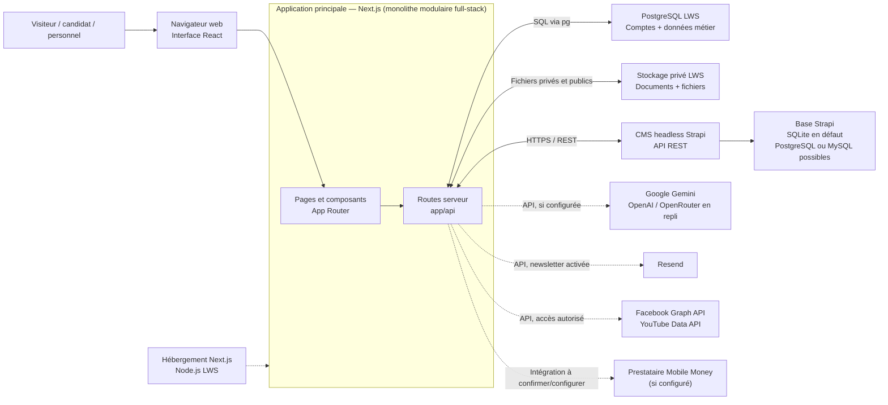

# Cahier des charges — Plateforme numérique de l'INPTIC

## 1. Objet du document

Ce document décrit le périmètre fonctionnel et les exigences principales de la
plateforme web de l'Institut National de la Poste, des Technologies de
l'Information et de la Communication (INPTIC). Il formalise les fonctionnalités
présentes dans le projet et les conditions nécessaires à leur mise en service.
Il ne vaut pas promesse de disponibilité d'un service externe non configuré.

## 2. Contexte et objectifs

La plateforme doit fournir un point d'accès numérique commun aux candidats,
étudiants, personnels, partenaires et visiteurs. Elle doit :

- présenter l'institut, ses formations, ses actualités et ses activités de
  recherche;
- accompagner les candidats de la préinscription au suivi de leur dossier;
- fournir des espaces de travail adaptés aux équipes autorisées;
- faciliter la publication et la consultation de contenus institutionnels;
- fonctionner sur les formats d'écran courants et permettre une navigation
  claire depuis un navigateur web.

## 3. Utilisateurs et habilitations

| Profil | Besoins principaux |
| --- | --- |
| Visiteur | Découvrir l'INPTIC, ses formations, actualités, services et coordonnées. |
| Candidat | Créer un compte, se préinscrire, déposer des pièces, suivre son dossier et consulter sa quittance. |
| Personnel de scolarité | Examiner les dossiers, traiter les candidatures et publier des documents étudiants. |
| Direction des études | Accéder aux outils qui lui sont attribués pour le suivi des études. |
| Direction générale | Consulter les indicateurs de suivi via l'espace de Direction réservé aux comptes Superadmin. |
| Communication | Gérer les annonces, actualités et activités de veille accessibles dans son espace. |
| Personnel RH | Consulter ou gérer les dossiers RH selon son niveau d'autorisation. |
| Administrateur | Administrer les espaces et opérations autorisés au compte. |

Les deux rôles administratifs sont `admin` et `superadmin`. Chaque compte
`admin` est associé à un seul service parmi Scolarité, Communication, Direction
des études et Ressources humaines; il ne voit et ne gère que cet espace. Le
`superadmin` est le seul rôle global : il peut voir tous les liens et accéder à
tous les espaces. Les droits sont vérifiés côté serveur pour chaque ressource
et action, et ne dépendent pas du seul affichage de la navigation. Les règles
de normalisation et les destinations sont centralisées dans
[`lib/roles.ts`](./lib/roles.ts).

## 4. Périmètre fonctionnel

### 4.1 Portail public

Le portail public est accessible à l'adresse officielle
[`https://inptic-ga.org`](https://inptic-ga.org). Il présente l'institut et sa
gouvernance, le catalogue de formations, les admissions, les actualités et
annonces, les concours et résultats, la recherche scientifique, la vie
étudiante, les entreprises, les alumni, les textes et lois, les contacts et
une visite 3D. Les pages de formation comprennent notamment les filières
Génie logiciel, Postes et logistique, Télécommunications, Monétique et
Cybersécurité. La page de gouvernance présente l'institut; aucun écran
d'organigramme séparé n'est défini dans le périmètre actuel.

L'accueil comprend un carrousel d'annonces, une présentation de formations,
des accès aux actualités, admissions et publications, des chiffres clés et un
agenda des événements. Un compte autorisé du service Communication ou un
Superadmin peut modifier et enregistrer les dates et intitulés de l'agenda.
Sur la page de présentation de l'institut, un compte autorisé peut également
modifier le message public de la Direction générale (titre, texte, nom et
fonction). Ces modifications sont persistées en base.

L'interface propose une recherche globale des formations et actualités, les
thèmes clair et sombre, le français, l'anglais, le chinois et l'arabe selon
les traductions disponibles, ainsi qu'une installation PWA depuis les
navigateurs compatibles. Le pied de page fournit les liens institutionnels,
les raccourcis sociaux configurés et un formulaire d'inscription à la
newsletter. Le partage ouvre les services externes; il ne publie pas
automatiquement de contenu sur les comptes institutionnels.

L'annuaire Alumni présente les profils sous forme de cartes avec portrait et
informations de parcours. Il permet la recherche par nom, filière, poste,
entreprise et promotion, ainsi que le tri des résultats. Un Alumni connecté
peut modifier son propre profil; les opérations de gestion globale sont
réservées au Superadmin.

### 4.2 Comptes et admissions

- Inscription publique des candidats et connexion des candidats et du
  personnel, avec authentification PostgreSQL sur l'hébergement LWS.
- Confirmation de l'adresse e-mail du candidat avant la première connexion;
  connexion OAuth Google si le fournisseur est configuré. La page de connexion
  publique propose Google, pas Facebook.
- Parcours de préinscription et dépôt du dossier officiel.
- Téléversement des pièces obligatoires selon les formats et limites présentés
  par le formulaire.
- Consultation de l'avancement du dossier et du statut de paiement.
- Demande de réinitialisation du mot de passe par courriel.
- Paiement via les moyens Mobile Money présentés dans l'application, sous
  réserve de la configuration et de la confirmation du prestataire. Le parcours
  actuel propose Airtel Money et Moov Money via SingPay pour des frais affichés
  à 20 000 FCFA.
- Génération et consultation d'une quittance lorsque le paiement est confirmé.
- Vérification publique d'une quittance par sa référence, au moyen du QR code.

La préinscription est liée à un compte candidat authentifié. Les écrans doivent
signaler les étapes manquantes et orienter le candidat vers l'action suivante.
Les pièces de candidature sont limitées aux formats et tailles indiqués par le
formulaire. Les migrations de base de données requises doivent être appliquées
avant l'utilisation en production.

### 4.3 Espaces du personnel

- **Annonces et communication** : créer, modifier et retirer des annonces;
  consulter les outils de veille technologique et d'e-réputation, examiner les
  mentions et commentaires disponibles, consulter les indicateurs d'engagement
  et préparer le partage sur les réseaux. La diffusion sociale reste à confirmer
  sur chaque plateforme et n'est pas exécutée automatiquement par le site.
- **Administration des comptes** : le Superadmin peut créer et supprimer les
  comptes du personnel, les rechercher et les filtrer par rôle ou service.
  Chaque compte Admin est limité à un seul service; le Superadmin a accès à
  l'ensemble des espaces.
- **Traçabilité globale** : le Superadmin dispose d'un journal central paginé
  et filtrable des actions API instrumentées, indiquant l'acteur connu, son
  rôle, son service/direction, l'opération, son résultat et sa date/heure. Les
  tentatives refusées sont conservées sans enregistrer les mots de passe ni le
  contenu des formulaires.
- **Concours** : gérer les fiches de concours, documents officiels,
  préinscriptions et résultats publiés.
- **Scolarité** : examiner, valider ou refuser les dossiers et publier des
  documents étudiants.
- **Direction** : consulter le tableau de bord et modifier les paramètres de
  compte proposés. Le tableau de bord présente les indicateurs disponibles et
  les accès rapides vers les espaces de gestion; les paramètres du compte de
  Direction sont conservés localement dans le navigateur.
- **Ressources humaines** : rechercher et gérer les profils, importer ou
  exporter des données, gérer les cartes/QR codes et consulter les statistiques
  et le journal d'audit, selon les permissions. Les cartes professionnelles
  imprimables sont recto-verso au format 55 × 85 mm. Le badge numérique reprend
  le style de la carte et affiche uniquement les champs autorisés dans la liste
  de visibilité du profil. Les réglages peuvent être cochés ou décochés
  individuellement ou en une fois; les changements sont enregistrés avec le
  profil et appliqués à la prochaine vérification du QR.
- **Alumni** : un Alumni connecté peut modifier son propre profil; le
  Superadmin peut créer, modifier et supprimer les profils. Les modifications
  enregistrées sont stockées dans la base partagée, et non uniquement sur
  l'appareil utilisé.
- **Catalogue et recherche** : gérer les ressources de formation et les
  publications scientifiques pour les comptes disposant des droits requis.
- **Accueil et présentation** : les comptes Communication et Superadmin
  peuvent modifier l'agenda de la page d'accueil et le message de la Direction
  générale sur la page de présentation de l'institut.

Les opérations sensibles doivent demander une confirmation lorsque cela est
prévu. L'archivage RH est réversible; la suppression définitive ou la révocation
d'un QR doit être présentée comme une action à vérifier avant confirmation.

### 4.4 Assistant, actualités et services complémentaires

- L'assistant conversationnel est accessible depuis le bouton flottant et
  `/chatbot`. Il peut traiter des questions écrites, proposer une dictée vocale
  selon le navigateur, fournir une lecture vocale des réponses et afficher les
  sources Web lorsqu'elles sont renvoyées par le fournisseur configuré.
- Les actualités permettent la consultation et les interactions de type
  appréciation et partage.
- Les outils de veille peuvent agréger des sources configurées, afficher leur
  état et préparer la diffusion d'un contenu.
- La newsletter permet l'inscription avec confirmation par courriel, l'envoi
  aux abonnés actifs lors de la publication d'une actualité et le
  désabonnement confirmé, lorsque les services et le schéma de données requis
  sont activés.

Le partage ouvre les services externes : il ne confirme pas qu'une publication
a été effectuée sur le compte institutionnel. Une réponse à un commentaire
Facebook peut être envoyée par un compte autorisé si l'API et les permissions
requises sont configurées; la réponse aux commentaires YouTube et la publication
automatique de nouveaux contenus sur les réseaux ne font pas partie du périmètre
décrit.

## 5. Exigences non fonctionnelles

- **Compatibilité** : application web fondée sur Next.js, React et TypeScript;
  prise en charge des navigateurs modernes et des écrans mobiles et de bureau.
- **Expérience d'interface** : fournir une navigation adaptée aux écrans
  mobiles et de bureau, des états de chargement/erreur/succès compréhensibles,
  un thème clair ou sombre et un sélecteur de langue. L'installation PWA dépend
  du support du navigateur et de la configuration HTTPS.
- **Accessibilité** : donner des libellés aux commandes et champs, rendre les
  contrôles utilisables au clavier et annoncer les états et erreurs de
  formulaire avec les mécanismes natifs de l'interface.
- **Sécurité des comptes** : les actions réservées doivent être vérifiées côté
  serveur à partir d'une identité authentifiée et d'autorisations fiables.
- **Protection des secrets** : les clés privées et jetons de service doivent
  rester dans les variables d'environnement serveur, sans préfixe
  `NEXT_PUBLIC_`.
- **Protection des données** : limiter l'accès aux informations de candidature
  et aux dossiers RH aux seuls comptes autorisés; ne rendre publiques que les
  données explicitement prévues.
- **Fiabilité des transactions** : afficher le statut confirmé par le prestataire
  avant de considérer un paiement comme réussi et prévenir les relances
  involontaires.
- **Traçabilité RH** : conserver les événements d'audit disponibles pour les
  opérations RH sensibles. Chaque scan d'un QR existant doit être journalisé
  avec le titulaire, sa fonction lorsqu'elle est renseignée, le résultat de la
  vérification et l'adresse IP lorsqu'elle est disponible. Un scan ne doit pas
  être présenté comme confirmé si son journal ne peut pas être écrit.
- **Confidentialité du badge RH** : les informations publiques doivent être
  filtrées côté serveur selon la liste de visibilité du profil. Les cases
  décochées ne doivent pas être retournées par la page de vérification ni par
  son API; les valeurs absentes du profil ne sont pas affichées.
- **Clarté** : présenter les états d'attente, d'erreur, de succès et les étapes
  à suivre sans assimiler une donnée de secours à une source vérifiée.
- **Maintenabilité** : centraliser les règles réutilisées, notamment les rôles,
  et documenter les configurations externes nécessaires.

## 6. Architecture et dépendances

### 6.1 Technologies utilisées

Les versions ci-dessous sont celles déclarées dans les manifestes du projet.
Les plages commençant par `^` indiquent la version minimale de la plage
semver déclarée, pas nécessairement la version exacte installée; les fichiers
lock déterminent les versions résolues lors de l'installation.

| Couche | Technologie | Version déclarée / rôle |
| --- | --- | --- |
| Runtime JavaScript | Node.js | `>=20` pour le site; Strapi déclare `>=20 <=26.x.x`. |
| Gestion des paquets | npm | Installation du site et de Strapi; fichiers `package-lock.json` séparés. |
| Framework web | Next.js | `16.3.4`; pages, rendu et routes serveur sous `app/`. |
| Interface | React / React DOM | React `^19.1.0` pour le site; React `^18.0.0` dans le CMS Strapi. |
| Langage | TypeScript | `^5.7.0` côté site; TypeScript `^5` côté Strapi. Compilation stricte activée côté site. |
| Styles | Tailwind CSS | `^4.1.0`, intégré par le plugin PostCSS `@tailwindcss/postcss`. Les styles propres sont aussi dans `app/globals.css`. |
| Icônes et animations | Lucide React / Lottie React | `lucide-react ^0.468.0` pour les icônes et `lottie-react ^3.1.2` pour les animations Lottie. |
| Traductions | i18next / react-i18next | `i18next ^26.4.2` et `react-i18next ^17.0.13`. |
| Visualisation 3D | Three.js / React Three Fiber / Drei | `three ^0.186.1`, `@react-three/fiber ^9.8.1`, `@react-three/drei ^10.7.9`; utilisés pour la visite 3D. |
| Authentification et accès aux données | PostgreSQL | Connexion serveur `pg`, sessions et comptes applicatifs stockés dans PostgreSQL; aucun SDK Supabase au runtime. |
| CMS | Strapi | Strapi `5.55.1` et plugin Users & Permissions `5.55.1`; API REST pour les contenus reliés au CMS. |
| Base du CMS | SQLite par défaut | `better-sqlite3 12.8.0`; la configuration Strapi permet aussi PostgreSQL ou MySQL selon `DATABASE_CLIENT`. |
| Services de données | PostgreSQL LWS | Comptes, données métier, profils, newsletter et métadonnées des fichiers; migrations SQL sous `scripts/`. |
| IA conversationnelle | Google Gemini et API HTTP | `/api/chat` appelle Gemini côté serveur; OpenAI et OpenRouter sont des fournisseurs de repli. Gemini peut utiliser la recherche Google, l'exécution Python et la synthèse vocale lorsque configurées. |
| Flux XML | fast-xml-parser | `^5.11.2`, pour les flux structurés consommés par les fonctions de veille. |
| QR codes | qrcode | `^1.5.4` (et types `@types/qrcode ^1.5.6`), notamment pour les cartes professionnelles. |
| Analytics | Vercel Analytics | `@vercel/analytics ^2.0.1`. |
| Processus locaux | concurrently | `^10.0.5`, pour lancer plusieurs services via les scripts npm. |

Les bibliothèques de test automatisé (framework de tests unitaires ou de tests
de navigateur) ne sont pas déclarées dans le manifeste principal. La commande
`npm run lint` exécute actuellement `tsc --noEmit` : elle vérifie les types et
la compilation TypeScript, mais ne remplace pas une suite de tests fonctionnels.

### 6.2 Architecture applicative et services

#### Type d'architecture

La plateforme suit une **architecture web client-serveur organisée autour d'un
monolithe modulaire full-stack Next.js**. L'interface, le rendu des pages et les
routes HTTP métier sont regroupés dans l'application Next.js. PostgreSQL et le
stockage privé sur disque de LWS sont la source de vérité des données applicatives.
Strapi reste un CMS distinct uniquement pour les contenus qui y sont encore gérés.

Le site utilise un déploiement applicatif LWS, PostgreSQL pour les données et
fichiers persistants sur disque privé; le CMS et les fournisseurs externes restent
des services distincts. Les échanges avec le CMS et les fournisseurs externes
passent par les routes serveur ou leurs API REST.

#### Schéma d'architecture

Les flèches en pointillés désignent des intégrations externes facultatives ou
conditionnées par leur configuration. Les navigateurs n'accèdent jamais
directement à PostgreSQL ou au stockage privé; les routes serveur contrôlent les
droits et servent les fichiers. L'hébergement Strapi et sa base restent séparés
du déploiement Next.js.

- **Frontend et backend web** : application Next.js avec App Router; les pages
  sont dans `app/`, les composants partagés dans `components/` et les routes
  HTTP applicatives dans `app/api/`. Les interfaces et routes sont écrites en
  TypeScript/TSX.
- **Authentification et données métier** : comptes, sessions et tables
  applicatives dans PostgreSQL LWS; les mots de passe sont hachés et le cookie
  de session est HttpOnly. Les rôles sont contrôlés côté serveur.
- **Fichiers** : documents privés et fichiers publics dans le stockage persistant
  LWS, avec métadonnées PostgreSQL; les liens des documents candidats sont
  protégés par la session et les droits du profil.
- **CMS** : Strapi 5 avec API REST, interface d'administration, rôles et
  permissions. Sa base de développement est SQLite par défaut; pour la
  production, choisir et configurer un stockage persistant approprié.
- **Courriels** : Resend pour les confirmations d'adresse, réinitialisations
  de mot de passe et envois de newsletter.
- **Assistant** : route `/api/chat`; Gemini est le fournisseur principal.
  Recherche Google, exécution Python et Gemini TTS dépendent des
  fonctionnalités disponibles et de la clé serveur. OpenAI ou OpenRouter
  peuvent être utilisés comme fournisseurs de repli si configurés; ces
  intégrations ne constituent pas un moteur local hors ligne.
- **Contenu de l'accueil** : l'agenda et le message de la Direction générale
  sont servis par des routes applicatives et persistés dans PostgreSQL. La
  consultation publique ne nécessite pas de session; les mises à jour sont
  limitées au service Communication et aux comptes Superadmin.
- **Réseaux et veille** : Facebook Graph API et YouTube Data API sont des
  intégrations optionnelles et nécessitent leurs identifiants et permissions.
  La lecture des commentaires dépend de ces intégrations; la réponse Facebook
  exige la permission `pages_manage_engagement`. Les liens de partage social
  lancent les services de partage et ne constituent pas une publication
  automatique.
- **Paiement** : l'interface propose les parcours Mobile Money présents dans
  l'application via SingPay (Airtel Money et Moov Money). Les identifiants du
  portefeuille et du prestataire doivent être configurés pour l'environnement
  cible; un statut en attente ne doit pas être traité comme un paiement confirmé.
- **Hébergement** : l'application Next.js et PostgreSQL sont hébergés sur LWS;
  Strapi est un service distinct qui doit être joignable pour les pages qui en
  dépendent. Les URL publiques du site et du CMS sont configurées séparément.
- **Template chatbot** : le dossier `chatbot/` est conservé comme référence;
  l'assistant utilisé par le site est intégré à l'application principale et
  n'exige pas de lancer cette seconde application.

### 6.3 Configuration technique et exploitation

La configuration se fait par variables d'environnement et ne doit pas être
commise avec les secrets. Les principales familles de configuration comprennent :

| Service | Paramètres indicatifs documentés |
| --- | --- |
| Site et base applicative | `DATABASE_URL`, `PRIVATE_STORAGE_DIR`, `AUTH_SITE_URL` (en production : `https://inptic-ga.org`); `NEXT_PUBLIC_SITE_URL` et `NEWSLETTER_SITE_URL` doivent utiliser la même origine publique lorsqu'ils sont définis. |
| Authentification et courriel | `GOOGLE_CLIENT_ID`, `GOOGLE_CLIENT_SECRET`, `RESEND_API_KEY`, `AUTH_FROM_EMAIL`; les URL de retour OAuth et d'authentification doivent correspondre au domaine officiel. |
| Strapi | `NEXT_PUBLIC_STRAPI_URL`, `STRAPI_API_TOKEN`; côté CMS, clés d'application et variables de connexion à sa base. |
| Assistant IA | `GEMINI_API_KEY` ou `GOOGLE_GENERATIVE_AI_API_KEY`; `GEMINI_MODEL`, `GEMINI_TTS_MODEL` facultatifs; `OPENAI_API_KEY` et `OPENROUTER_API_KEY` pour les fournisseurs de repli. |
| Newsletter | `RESEND_API_KEY`, `NEWSLETTER_FROM_EMAIL`, `NEWSLETTER_SITE_URL`. |
| Réseaux sociaux et veille | `FACEBOOK_PAGE_ID`, `FACEBOOK_PAGE_ACCESS_TOKEN`, `FACEBOOK_GRAPH_API_VERSION`, `YOUTUBE_API_KEY`. |
| Paiement Mobile Money | `SINGPAY_GATEWAY_URL` (facultatif), `SINGPAY_CLIENT_ID`, `SINGPAY_CLIENT_SECRET`, `SINGPAY_WALLET_ID`, `SINGPAY_DISBURSEMENT_ID` selon le mode d'exploitation SingPay. |
| Base Strapi | `DATABASE_CLIENT` (`sqlite`, `postgres` ou `mysql`) et paramètres de connexion correspondants. |

Les clés privées, jetons d'administration et clés de service doivent rester côté
serveur et ne jamais être préfixés par `NEXT_PUBLIC_`. Les noms sont fournis à
titre de référence : l'exploitant doit suivre le README et les fichiers
d'exemple du service concerné, sans publier leurs valeurs.

Commandes npm du dépôt :

| Commande | Fonction |
| --- | --- |
| `npm run dev` | Démarrer le site en développement. |
| `npm run dev:strapi` | Démarrer Strapi en développement. |
| `npm run build:next` | Construire le site Next.js. |
| `npm run build:strapi` | Installer les dépendances de Strapi puis construire le CMS. |
| `npm run build` | Construire le site puis le CMS. |
| `npm run lint` | Exécuter la vérification TypeScript (`tsc --noEmit`). |
| `npm run start` / `npm run start:strapi` | Démarrer séparément le site ou le CMS en mode production. |

Les migrations SQL `scripts/*.sql` correspondent à des fonctions distinctes.
Créer la base dans le panneau LWS puis exécuter
`scripts/00_lws_complete_schema.sql` avant le démarrage. Ce script regroupe le
schéma applicatif, l'authentification, les profils, les fichiers et la newsletter;
il ne copie aucune donnée ancienne. Appliquer également les scripts de réparation
ou de migration requis par les fonctions activées, notamment ceux de l'agenda
d'accueil, du message de la Direction générale et de la propriété Alumni. Vérifier
les consignes et l'ordre d'exécution dans le README avant de les exécuter.

Une défaillance ou une absence de configuration d'un fournisseur tiers peut
désactiver uniquement les fonctions dépendantes de ce fournisseur; l'interface
doit éviter de présenter ces fonctions comme opérationnelles lorsqu'elles ne le
sont pas.

## 7. Données principales

Les contenus gérés ou présentés incluent les formations, actualités et annonces,
concours, préinscriptions, dossiers candidats, publications scientifiques,
ressources pédagogiques, profils RH, cartes professionnelles, abonnements à la
newsletter et historiques associés. Les données personnelles et documents
déposés doivent être accessibles uniquement selon les permissions prévues.

Les champs détaillés, formats et limites de téléversement sont définis par les
formulaires et collections actuellement implémentés. Les annonces, actualités,
comptes, dossiers, messages de l'accueil, agenda, profils Alumni et RH sont
administrés dans PostgreSQL. Les pages de formation utilisent les données
éditoriales Strapi lorsqu'elles y sont hébergées; les ressources PDF et vidéo
gérées dans le catalogue sont stockées par les routes applicatives et PostgreSQL.
Les comptes et dossiers passent par les routes serveur connectées à PostgreSQL
et au stockage LWS.

## 8. Mise en service

Avant une mise en production, l'exploitant doit :

1. fournir les variables publiques et secrètes attendues par l'environnement,
   en conservant les secrets uniquement côté serveur;
2. appliquer les scripts de schéma PostgreSQL LWS; les comptes et données sont
   créés sur cette nouvelle base, sans import historique;
3. appliquer les migrations SQL requises par les parcours activés;
4. configurer le domaine public `https://inptic-ga.org`, les URL OAuth Google,
   les courriels et la réinitialisation du mot de passe; mettre à jour les URL
   de retour autorisées chez les fournisseurs;
5. configurer Strapi, ses permissions de lecture publique et les jetons
   d'écriture nécessaires;
6. activer et vérifier chaque fournisseur externe utilisé (paiement, courriel,
   réseaux sociaux, IA);
7. tester les parcours de candidat, les pages publiques et chaque espace de
   personnel avec des comptes de test aux rôles distincts.

Les noms exacts des variables, les étapes opérationnelles et les précautions de
déploiement figurent dans [`README.md`](./README.md).

## 9. Critères de recette

La livraison est considérée conforme lorsque les vérifications suivantes
réussissent dans l'environnement cible :

- les pages publiques principales et leurs liens de navigation sont accessibles
  sur mobile et ordinateur;
- le domaine officiel `https://inptic-ga.org` est utilisé dans les liens
  de métadonnées absolues lorsqu'elles sont définies, les courriels
  transactionnels, la newsletter et les URL QR générées côté serveur;
- la navigation, la recherche, les langues disponibles, les thèmes clair/sombre
  et l'installation PWA fonctionnent conformément au support du navigateur;
- un candidat peut créer/utiliser son compte, compléter le parcours requis,
  confirmer son adresse e-mail, se préinscrire, déposer les pièces attendues et
  retrouver l'état de son dossier;
- un paiement n'est indiqué comme confirmé qu'après confirmation du fournisseur;
- le paiement est initié avec l'opérateur choisi, le numéro fourni et le montant
  affiché; une transaction en attente ou en échec ne produit pas de quittance
  confirmée;
- un compte autorisé peut accéder aux actions correspondant à son rôle, tandis
  qu'un compte sans droit ne peut pas les exécuter;
- un compte Superadmin peut créer, filtrer et supprimer les comptes du personnel;
  un compte Admin reste limité au service qui lui est attribué;
- le Superadmin peut consulter et filtrer le journal central des actions API,
  avec l'auteur, le service/direction, l'heure et le résultat; les comptes non
  Superadmin ne peuvent pas consulter ce journal;
- les comptes Communication et Superadmin peuvent modifier l'agenda et le
  message de Direction, et les changements enregistrés restent visibles après
  rechargement;
- les inscriptions à la newsletter nécessitent une confirmation par courriel,
  les actualités publiées prévues sont envoyées aux abonnés actifs et le lien
  de désabonnement fonctionne;
- un profil RH peut régler la visibilité de chaque champ de badge, et seule la
  sélection enregistrée est renvoyée et affichée après un nouveau scan;
- chaque scan d'un QR existant crée une entrée d'audit contenant le nom du
  titulaire et sa fonction lorsqu'elle est renseignée; une panne d'écriture du
  journal empêche de confirmer le scan;
- l'impression d'une carte professionnelle produit les deux faces au format
  55 × 85 mm et le badge numérique utilise les champs de visibilité autorisés;
- l'annuaire Alumni peut être recherché et trié, un compte Alumni ne peut
  modifier que son profil, et le Superadmin peut administrer l'ensemble des
  profils;
- les contenus publiés dans le CMS sont consultables depuis le site;
- les fonctions qui dépendent d'une intégration absente indiquent leur
  indisponibilité sans simuler une réussite;
- les secrets restent absents du code client et les fonctions d'administration
  restent protégées côté serveur.

## 10. Limites et évolutions à cadrer

Les intégrations externes peuvent nécessiter des contrats, clés, permissions ou
validations propres à chaque fournisseur. La publication automatique sur les
réseaux sociaux, la réponse automatique YouTube et la synchronisation
multi-appareils de certains paramètres locaux ne sont pas garanties par la
version décrite. Toute extension de ces fonctions devra préciser les comptes
concernés, les permissions, la conservation des données et les critères de
validation avant développement.
